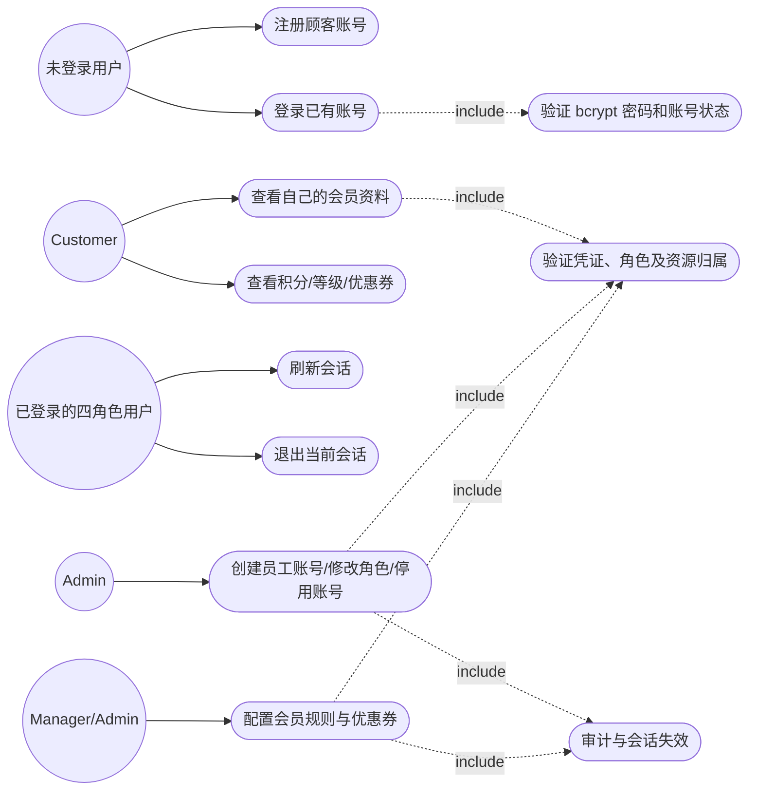
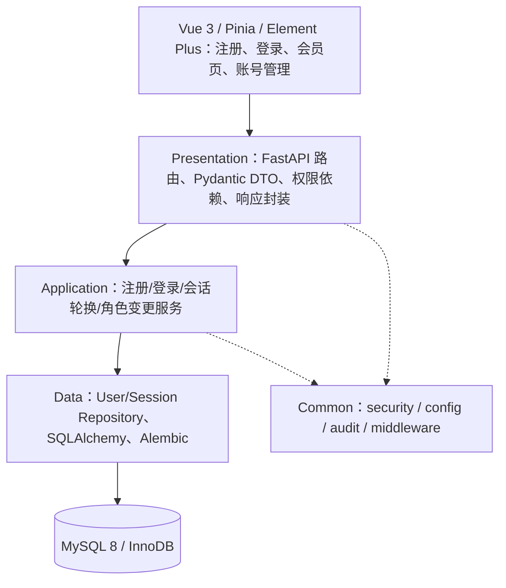
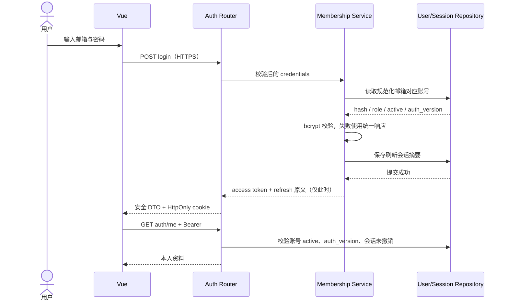
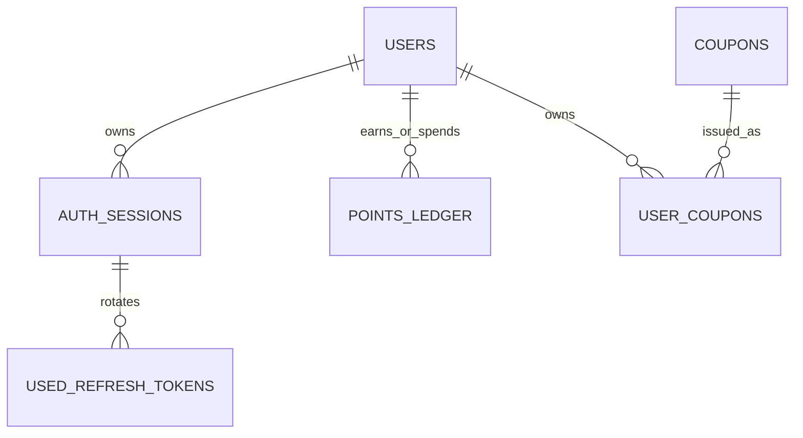

# Member10：会员认证与权限需求及设计

里程碑：Requirement & Design / Project Update 1，2026-10-12。
负责人：Member10；协作：Member4（积分、等级、优惠券）、Member1（公共认证/API）、Member8（数据库）。
本文是可评审的设计交付，尚未实现接口，也不代表团队已经批准新增契约。

## 1. 范围与依据

新版提案 Objective (c) 将会员模块分配给 Member10 和 Member4，实现截止为
2026-11-23；10 月 12 日是全组需求与设计截止。旧《项目阶段》中的本地 JSON/CSV、
Member10 测试及手册分工与新版提案、仓库 README 不一致，本文采用新版范围。
不引入在线支付、短信或商业云数据库。

依据（均已阅读）：

- 用户提供的新版 `JC2001 Group Project Proposal`：第 4 页设计里程碑，第 6 页会员模块。
- 用户提供的《成员上手指南》：个人分支、PR、共享契约协调和关键日期。
- 用户提供的《项目阶段》：用于识别旧分工，不沿用本地文件存储设计。
- 用户补充的《技术选型》：Python 3.11、FastAPI、SQLAlchemy 2、Alembic、MySQL 8.0.12、
  Vue 3 / Vite / TypeScript、Pinia、Element Plus、PyJWT、passlib[bcrypt]、slowapi。
- [主线架构](ARCHITECTURE.md)及 [README](../../README.md)：基线提交
  `f13e670c10c07eea2e1ea4b8bd01e679c43a0332`。
- [需求评审稿](https://github.com/Isss10/bmis-group4-restaurant-system/blob/384b8cfd24089aac2973419e5ab2abfb19b7b5a2/docs/requirements/REQUIREMENTS.md)：
  M10 = FR-MEM-01/02 和 FR-MEM-06 的角色变更部分；M4 = FR-MEM-03/04/05。
- [契约对齐评审分支](https://github.com/Isss10/bmis-group4-restaurant-system/tree/843409fb670ff59dc413c48e80a60f419b50c7a1)：
  统一 envelope 与 `30001/30002/30003` 仍待合入主线，不宣称已在 main 生效。

需求评审稿提及的《协作与统一标准手册》未包含在本次提供文件及主线中。
因此下列权限细则、接口路径、数据库扩展和业务参数是评审建议，实施前须与该手册核对。
四个角色、三层结构、关系型存储和审计要求已有主线依据。

## 2. 分工与需求

| 编号 | 可验收需求 | Owner | 依据/状态 |
|---|---|---|---|
| FR-MEM-01 | 顾客自助注册；四角色已有账号登录；返回 access token，支持刷新和退出 | M10 | 总需求来自评审稿；自助注册只能创建 customer |
| FR-MEM-02 | 服务端逐接口校验角色和资源归属；无有效凭证为 401，权限不足为 403 | M10 + 各模块 | 主线 Role/guard 已有，用户状态检查待实现 |
| FR-MEM-03 | append-only 积分账本，支持赚取、兑换、过期及调整 | M4，M10 配合身份 | 主线承诺；消费和过期算法须统一 |
| FR-MEM-04 | 根据约定指标计算会员等级 | M4 | 等级名见需求评审稿；阈值未确认 |
| FR-MEM-05 | 优惠券有效期、归属、门槛、叠加顺序和重复使用校验 | M4 + M5 | 叠加词汇见需求评审稿，顺序待评审 |
| FR-MEM-06 | 角色变更、积分调整、优惠券发放/兑换写审计，与业务同事务提交 | M10（角色），M4（积分/券） | 审计工具已有，接入待实现 |

M10 不承担 M4 的实现，也不替 M8 修改已有 migration。本轮交付设计、测试计划和进度内容。

## 3. 用例视图

以下为用例关系视图；箭头标明参与者和必须执行的子流程。



| 用例 | 主流程 | 失败分支 |
|---|---|---|
| UC-M10-01 注册 | 校验邮箱/密码，规范化邮箱，bcrypt 哈希，唯一约束插入 customer | 重复邮箱并发注册仅成功一次；额外 role 字段拒绝 |
| UC-M10-02 登录 | 通用失败响应，验证密码与 active 状态，签发最小 JWT 和刷新会话 | 错误密码、未知邮箱、停用账号均不给令牌；限流 |
| UC-M10-03 查看自己 | 验签后从服务端加载账号，仅返回许可的字段 | 过期令牌 401；不得用请求中的 user_id 访问他人 |
| UC-M10-04 刷新/退出 | 原子轮换 refresh token；退出撤销当前会话 | 过期、撤销、重放不签发新令牌 |
| UC-M10-05 管理账号 | admin 校验目标，锁账号，变更 role/status，撤销旧会话，写审计 | 非 admin 拒绝；阻止删除最后一个 active admin |

## 4. 权限矩阵（供契约评审）

角色值复用 `src/common/security.py` 的 `customer / waiter / manager / admin`。
服务端显式列出允许角色；`require_roles` 本身不自动提供继承关系。
表中的 staff 包含 waiter、manager、admin，细项仍须与标准手册核对。

| 操作 | Public | Customer | Waiter | Manager | Admin |
|---|---|---|---|---|---|
| 自助注册/登录 | 允许 | 允许 | 允许 | 允许 | 允许 |
| 查看自己的安全资料/退出 | 否 | 自己 | 自己 | 自己 | 自己 |
| 顾客预约/点餐/评价/积分/券 | 否 | 自己 | 否 | 否 | 否 |
| 处理预约/订单/审核评价 | 否 | 否 | 允许 | 允许 | 允许 |
| 看板、会员规则/券配置、审计查询 | 否 | 否 | 否 | 允许 | 允许 |
| 创建员工/修改角色/停用用户 | 否 | 否 | 否 | 否 | 允许 |

注册接口不接受角色选择，也不允许前端隐藏按钮充当授权。顾客账号与 staff 账号分开；
admin 的管理权限不绕过“实际完成订单才可评价”等业务规则。
首个 admin 通过一次性本地 bootstrap 命令建立，从环境读取凭证，不提交默认密码。

## 5. 三层结构与已有代码复用



- 路由拟放 `src/presentation/api/routers/auth.py`、`users.py`；业务服务放
  `src/application/membership/`，不 import FastAPI；SQL 和锁仅在 data 层。
- 复用 `hash_password`、`verify_password`、`create_access_token`、`Role`；
  扩展账号实时状态和 refresh 验证能力须由 M1/M10 联合评审。
- 复用 `get_db`、事务回滚和 `record_audit`；禁止直接返回 ORM 对象。
- 主线 `main.py` 的自动发现约定把 router 放 application，与架构的禁止 FastAPI
  依赖规则存在冲突。交由 M1 统一 presentation 注册方式，本轮不修改共享注册器。

## 6. 接口候选与输入输出

表中路径和扩展字段尚未冻结；需 M1 同意后才生成正式 OpenAPI。已有
`GET /api/v1/auth/me` 应保留兼容性，不新增平行的“当前用户”入口。

| Method / path（候选） | 输入摘要 | 返回 data 摘要 | 权限 |
|---|---|---|---|
| POST /api/v1/auth/register | email, password, display_name | id, display_name, role | public，强制 customer |
| POST /api/v1/auth/login | email, password | access_token, token_type, expires_in | public |
| POST /api/v1/auth/refresh | refresh cookie | 新 access token，轮换 cookie | 有效刷新会话 |
| POST /api/v1/auth/logout | refresh cookie | logged_out | 当前会话；重复退出幂等 |
| GET /api/v1/auth/me | Bearer access token | id, display_name, role, is_active | 四角色自己的账号 |
| POST /api/v1/users | email, password, display_name, role | 账号安全字段 | admin |
| PATCH /api/v1/users/{id}/role | role, version | 更新后安全字段 | admin |
| PATCH /api/v1/users/{id}/status | is_active, version | 更新后安全字段 | admin |
| GET /api/v1/membership/me | Bearer access token | points, tier, coupons | customer 自己，M4 负责 |

候选校验：邮箱非空、合法且规范化后唯一；display_name 为 1..80 字符；密码
建议至少 12 字符且 UTF-8 编码不超过 bcrypt 的 72 字节，禁止静默截断。
注册 DTO 拒绝额外字段；角色使用 Role enum；version 为正整数。
密码仅用于哈希/验证，不进入日志、JWT、审计快照或任何输出 DTO。

响应复用主线封装；契约对齐分支合入后遵循
`code / message / data / request_id / timestamp`，不能自行混用两套格式。
拟采用评审稿的 `30001`（缺凭证）、`30002`（无效凭证/登录失败）、
`30003`（无权限），分别对应 401、401、403。重复邮箱冲突和限流的
业务码尚未分配，向 M1 申请，禁止擅自占号；候选 HTTP 状态为 409、429。

## 7. 认证生命周期与安全

候选策略：access token 60 分钟（主线配置默认值）；refresh token 7 天（需求评审稿）。
登录成功返回 access token，前端仅保存在 Pinia 内存，不写 localStorage。
refresh token 拟为高熵随机值，原文仅放 HttpOnly、Secure、SameSite cookie，
数据库存摘要；需要与评审稿“refresh token 返回方式”核对后冻结。
cookie 的 Path 覆盖 `/api/v1/auth`；跨域 CORS 精确白名单，refresh/logout 校验
Origin 和 CSRF token。跨站部署若需 SameSite=None，必须 Secure 且仍做 CSRF 校验。



JWT 只携带必要 claims；既有 `sub/role/iat/exp/jti` 保留。
候选扩展 `sid`（会话）和 `auth_version`（权限版本），由 M1 在签发和验证两侧同时接入。
验签限定 HS256；refresh token 不能作为 access token 使用。
未知用户也执行 dummy bcrypt 验证，减小账号枚举的时间差。
登录限流候选 5 次/分钟/IP，加规范化账号维度限制；具体配置及 429 码待 M1 评审。

每次受保护请求校验账号 active、auth_version 和 session 未撤销，不能只信任 JWT role。
角色变更/停用：事务内锁账号，更新权限版本，撤销其全部会话并写审计；
旧 access/refresh 随即被拒绝。已授权且正在执行的请求不承诺追溯撤销。
退出撤销当前 session，重新退出仍成功；前端同时清除内存令牌。
刷新时锁 session，校验摘要与状态，原子轮换；并发刷新至多一次成功。
已用 refresh token 重放时撤销该 session；前端用 single-flight 避免并发刷新。

## 8. 关系型数据设计候选（M8 评审后新增 migration）

`users` 为主线架构已有概念；下面是扩展建议，不是已经存在的 ORM/DDL。

| 实体 | 字段要点 | 不变量与索引 |
|---|---|---|
| users | id, email_normalized, display_name, password_hash, role, is_active, auth_version, version, created_at, updated_at | UNIQUE email_normalized；四角色限制；version 乐观锁 |
| auth_sessions | id/sid, user_id, token_family_id, current_refresh_digest, expires_at, revoked_at, created_at | UNIQUE current_refresh_digest；user FK；按 user_id/revoked_at 查会话 |
| used_refresh_tokens | digest, session_id, used_at, expires_at | UNIQUE digest；用于识别已轮换 token 重放，过期后才清理 |
| audit_logs | 复用主线 AuditLog | actor、对象、before/after、request_id；禁止 credential 字段 |
| points_ledger / tiers / coupons / user_coupons | M4 业务设计 + M8 数据模型 | M10 只提供 user_id、role、active，不另建用户表 |



所有时间存 UTC，API 按统一 ISO 8601 格式输出；业务过期比较使用一个事务的同一时刻。
注册冲突由数据库唯一约束兜底，不使用“先查不存在再插入”作为并发保证。
admin 角色变更带 version；阻止最后一个 active admin 被停用/降级时，须锁定统一
的管理约束记录，防止两个 admin 同时降级留下零个管理员。
普通 JWT 校验不得持有数据库锁跨越整个 HTTP 请求。

## 9. 与 Member4 的积分/优惠券交接

- 订单完成后，由 M5 发布稳定的 order_id/user_id/最终应计金额；M4 按
  `(order_id, event_type)` 幂等记账；身份从服务端订单取得，不信任客户端 user_id。
- append-only 不等于只对“未过期 delta”求和：负数兑换须分配到具体赚取批次，
  过期仅扣剩余量，防止已消费积分被再次过期扣除。M4/M8 需统一批次分配模型。
- 等级建议用累计合格消费/累计 earned 指标，避免兑换后立刻降级；指标与阈值待确认。
- 优惠券归属、过期和最小消费由 M4 校验；M5 订单金额与券消耗同事务落库，
  同一 user_coupon 并发消费只能成功一次，禁止只在前端计算折扣。
- 推荐讨论值：每实付 ¥10 得 1 分、赚取后 12 个月过期；STACKABLE 先百分比再固定额，
  EXCLUSIVE 不叠加，总折扣不超过原金额。均来自需求评审稿的建议，尚非组内决定。
- 明确过期边界 `now >= expires_at`；券门槛基于折前金额、Decimal 舍入到分的时机、
  等级折扣与券是否叠加、退款/取消后的积分与券处理，都须由 M4/M5 冻结。

## 10. 页面线框与实施顺序

```text
登录/注册                 顾客会员页                  Admin 账号管理
[邮箱____________]        昵称 / 角色 / 等级            [搜索] [角色筛选]
[密码____________]        积分余额 [账本明细]           账号 | 角色 | 状态
[登录] [去注册]           优惠券：有效期 / 门槛         [创建员工] [修改角色]
错误：统一提示            [返回预约/菜单] [退出]        [停用] -> 确认目标与影响
```

登录成功根据服务端角色跳转顾客/员工/经理页面；用户无权访问时显示 403。
页面刷新通过 cookie 刷新恢复会话；失败返回登录；不无限重试、不在 URL 放 token。
资料页不接受任意 user_id。角色修改确认框显示目标账号、新旧角色及会话失效提示。

| 顺序 | M10 交付 | 依赖 |
|---|---|---|
| 10/12 | 本设计、验收计划、Update 1 内容 | 文档 PR 评审 |
| 第一轮实现 | DTO、User Repository、注册/登录与本人资料 | M1 契约、M8 users migration |
| 第二轮实现 | refresh/logout、状态实时校验、admin 管理与审计 | M1 JWT 扩展、M8 session migration |
| 第三轮实现 | Vue 页面与 M4 会员信息联调 | M4 loyalty API |
| 11/23 前 | 会员模块实现验证；OpenAPI 和操作说明更新 | 单元/集成/安全测试及 CI |

设计验收与待确认项见 [测试计划](../testing/MEMBERSHIP_MEMBER10_ACCEPTANCE.md)。
本轮不变更共享 API、角色 enum、CI、DDL 或 migration；实施前用契约评审 PR 协调。
