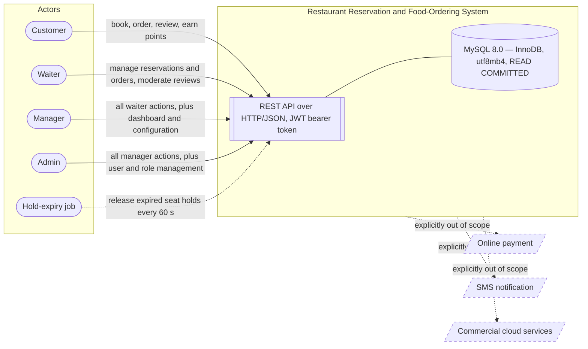

<!--
  AUTHOR: M1 (YAN ZHANG)   SUPPORT: all members
  TARGET: 4–5 pages        DUE: 16 Nov 2026
  STATUS: draft v1 — needs the group's read-through before merge
  SOURCES: group proposal (Problem / Solution / Benefits / Objectives),
           docs/requirements/REQUIREMENTS.md §1–2, docs/design/ARCHITECTURE.md §1–2
  RULE: no source code. Describe and explain only.
-->

# 1. Introduction & Project Context

## 1.1 Background and motivation

Small and medium-sized restaurants still run a large share of their front-of-house
operations on paper and telephone calls. Bookings are taken by phone and written into a
register; customers order from printed menus; staff transcribe orders by hand. Each of
these steps is a place where information can be lost, duplicated or misread.

Three consequences follow, and they compound. **Booking conflicts** arise because nothing
in a paper register prevents two members of staff from accepting the same table for the
same evening slot; manual registers and basic online booking tools are reported to be
particularly error-prone during peak hours, with double booking as the characteristic
failure [1], [2]. **Reservation records are lost** because the register is a single
physical artefact with no backup and no history. **Order-entry errors** arise because a
dish is transcribed at least twice — once by the waiter, once by whoever totals the bill —
and neither transcription is validated against the menu. Digitising the reservation process
has been reported to reduce manual errors and streamline resource management more
generally [3].

The same manual workflow also deprives the restaurant of data. A register records what
happened but cannot be queried: the manager cannot ask which hours are busiest, which
tables turn over fastest, or how many confirmed bookings never arrived. Decisions about
staffing and menu composition are therefore made on intuition rather than evidence.

Digital tools that already exist do not close the gap. Simple booking utilities that keep
their state in local files cannot guarantee that a booking operation is atomic, so two
customers submitting at the same moment can still end up holding the same table. And
because such tools do not tie a review to a real order, the feedback they collect is not
trustworthy: a single five-star review from a friend carries the same weight as two hundred
reviews from paying customers.

This project addresses that gap with a proof-of-concept system whose central technical
claim is narrow and testable: **two customers can never hold the same table for the same
time slot, even when they book at the same instant.**

## 1.2 Project scope

The deliverable is a proof-of-concept web system for a single-tenant restaurant, organised
into five functional modules:

| Module | Purpose | Proposal objective |
|---|---|---|
| Reservation | Browse free slots, book a table, cancel, and manage the booking lifecycle | (a), (d) |
| Ordering | Browse the menu by category, submit an order against an active reservation | (a) |
| Membership & Loyalty | Registration and login, role-based access, points ledger, tiers, coupons | (c) |
| Ratings & Reviews | Order-verified reviews, moderation queue, Bayesian-average ranking | (c) |
| Analytics | Revenue trend, table turnover, hourly demand heat map, no-show rate, dish recommendation | (e) |

A staff backend exposes reservation and order management to waiters, managers and
administrators (objective b). Cross-cutting engineering concerns — a documented REST API,
automated testing, continuous integration, security hardening, audit logging and
containerised deployment — together with the user manual are treated as first-class
deliverables rather than as afterthoughts (objective f).

The full functional and non-functional breakdown, with stable requirement identifiers, is in
chapter 2 and in `docs/requirements/REQUIREMENTS.md`.

### Explicit exclusions

Three things are out of scope for the whole project, by decision rather than by oversight:

- **Online payment.** No payment gateway is integrated. Orders are recorded and settled
  outside the system.
- **SMS notification.** Confirmations and reminders are in-app only.
- **Commercial cloud services.** No managed database, payment or messaging API is used. All
  data is stored in a self-hosted relational database, which is also what makes the
  transactional guarantees in chapter 5 possible to reason about.

These exclusions are revisited as future work in chapter 13.

## 1.3 The four actors

The system recognises four human roles, fixed for the duration of the project:

- **Customer** — books tables, browses the menu, places orders, reviews dishes they have
  actually ordered, and accumulates loyalty points.
- **Waiter** — sees all reservations, advances reservation and order status, and works the
  review moderation queue.
- **Manager** — everything a waiter can do, plus the analytics dashboard, coupon and tier
  configuration, and audit-log queries.
- **Admin** — everything a manager can do, plus user and role management.

One non-human actor completes the picture: a **hold-expiry job** that releases temporary
seat holds whose lifetime has elapsed. It is modelled as a system actor because it triggers
behaviour with no user present, and because the correctness of the booking guarantee
depends on it (§4 and chapter 5).

Roles are carried as a claim in a JSON Web Token and enforced server-side on every endpoint.
The role-to-endpoint matrix is fixed in the group's internal contract and reproduced in
chapter 2 where a requirement depends on it.

**Figure 1.1** gives the system context: who interacts with the system, across what boundary,
and what sits outside it. Chapter 4 develops this into the full context and architectural
models.

*Figure 1.1 — System context. Solid arrows are actor interactions across the HTTP boundary;
the dashed arrow is the system actor. The three dashed boxes on the right are permanently out
of scope by decision (§1.2), revisited as future work in chapter 13.*

## 1.4 Approach

The prototype is built as a three-tier application — presentation, application, data — over
a MySQL 8.0 InnoDB database, with a FastAPI backend exposing a documented REST API and Vue 3
single-page clients built with Vite and TypeScript. Chapter 4 sets out the architecture and
the reasoning behind it; the short version is that a three-tier split gives the concurrency
guarantee exactly one home, allows ten people to work in parallel without stepping on each
other, and makes the HTTP boundary a natural seam for testing.

The proposal's five modules map onto these client surfaces unevenly, and this report
describes what actually ships rather than what was planned: a customer-facing app (menu
browsing, cart and order submission) under `frontend/`, and a separate membership
authentication app under `src/presentation/membership/`. A manager dashboard component
(`AnalyticsDashboard.vue`) and the staff back-office exist as code but are, as of this
writing, only partially surfaced to the user; chapter 11 records these gaps explicitly and
chapter 12 evaluates the system against each objective on that honest basis.

The booking guarantee rests on three independent layers rather than one: a database
transaction, an optimistic-locking version check, and a unique constraint as a final safety
net. Chapter 5 explains why all three are needed and why any one of them alone is
insufficient. Chapter 12 presents the automated concurrency test that demonstrates the
guarantee under parallel load.

Engineering quality is instrumented rather than asserted. A continuous-integration pipeline
runs repository hygiene, linting, static type checking, a security scan, unit tests,
integration and concurrency tests against a real MySQL instance, a frontend build and a
Docker build on every pull request, and merging requires the aggregate result to be green.
Chapter 11 covers this in detail, together with the hardening work against the OWASP Top 10.

## 1.5 Contributions and report structure

The work was divided across ten members, each owning one module or one cross-cutting
concern end to end — code, tests, documentation and the corresponding chapter of this
report. Appendix A records the individual contributions in the school's template.

The remainder of this report is organised as follows. Chapter 2 states the functional and
non-functional requirements. Chapter 3 models them as use cases. Chapters 4 and 5 present
the system architecture and the database design. Chapters 6 to 10 describe the
implementation of each module: reservation and ordering, the staff backend, membership and
loyalty, ratings and reviews, and analytics with recommendation. Chapter 11 covers
engineering quality. Chapter 12 presents the testing strategy and results, including the
concurrency evidence and an evaluation of the delivered system against each stated
objective. Chapter 13 draws conclusions and identifies realistic directions for further
development.

## 1.6 Context of delivery

This report accompanies three other deliverables: the proof-of-concept software, supplied as
an archive containing the source, a runnable version, its dependencies and a user manual;
the project presentation, supplied as slides and a recorded video; and the group workload
profile in Appendix A. The three must describe the same system — where this report
describes a capability, the software implements it and the presentation demonstrates it.

---

## References cited in this chapter

> **Provisional.** The report's citation style is not yet settled — see `references.md`,
> which requires the group to choose **one** of IEEE or Harvard and apply it throughout. The
> bracketed numbering used here is IEEE-style. If the group chooses Harvard, these become
> author-date citations and the in-text markers in §1.1 must be changed to match.

The three sources cited in §1.1 are logged as **candidates** in `references.md` with the
verification each one still needs. They are not yet approved entries. Numbering is local to
this draft and will be renumbered globally at merge time.

---

## Author's notes — to resolve before merging

- [ ] **Length check.** This draft is roughly 2.5–3 pages at the required formatting. The
      target is 4–5. §1.1 now carries citations [1]–[3] (candidates logged in
      `references.md`, all still to be verified). The remaining expansion should come from
      evidence, not restatement: a quantified no-show figure would strengthen §1.1
      considerably, but the one M1 found (2.33 %, Resos No-Show Index 2026) is
      **single-source and vendor-published** — see the caution in `references.md` before
      using it. The academic alternatives listed there are better.
- [x] **Add a system context diagram** — added as Figure 1.1 in §1.3 (actors, the HTTP/JSON
      boundary, MySQL, the hold-expiry job, and the three out-of-scope integrations). Chapter 4
      develops it into the full context and architectural models.
- [x] **Objective lettering — settled 15 Nov against the submitted proposal PDF.** The
      submitted proposal numbers its objectives **(a)–(g)**, and `REQUIREMENTS.md` §7 uses
      the same lettering, so there is no discrepancy to reconcile. Mapping, for every chapter
      to use: (a) customer-side module · (b) staff backend · (c) membership & loyalty +
      ratings & reviews · (d) concurrency-correct booking **and** functional/integration/
      concurrency testing · (e) manager dashboard + hybrid recommender · (f) engineering
      quality **and** the user manual · (g) proposal, updates, presentation.
      ⚠️ An earlier draft that circulated in the group working folder used (a)–(i) and put
      the user manual under (d). **That draft is not the submitted one — do not cite it.**
      Chapters 11 and 12 were corrected on 15 Nov for exactly this reason.
- [x] **§1.4 client surfaces — corrected to match what ships (16 Nov).** Verified against
      `main`: there are two separate Vue projects (`frontend/` customer app,
      `src/presentation/membership/` auth app). `AnalyticsDashboard.vue` exists but is **not
      imported or mounted** by `App.vue`, and the staff back-office is only partly surfaced, so
      §1.4 no longer claims three working clients. ch.11 records the gaps; ch.12 evaluates
      against them honestly.
- [ ] Get every member to read §1.2's module table once. It is the single paragraph that
      tells the examiner what the group built; a wrong description here is expensive.
