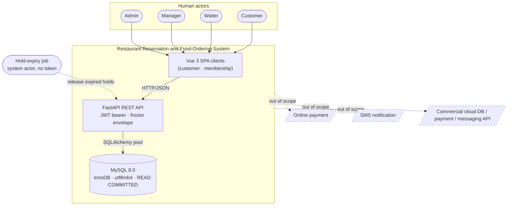
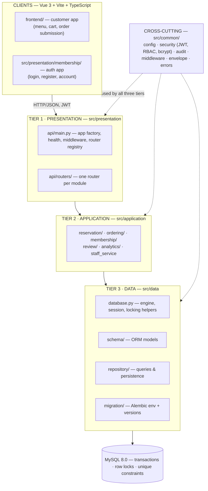
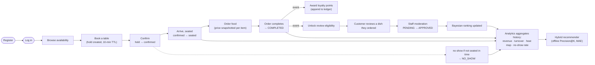
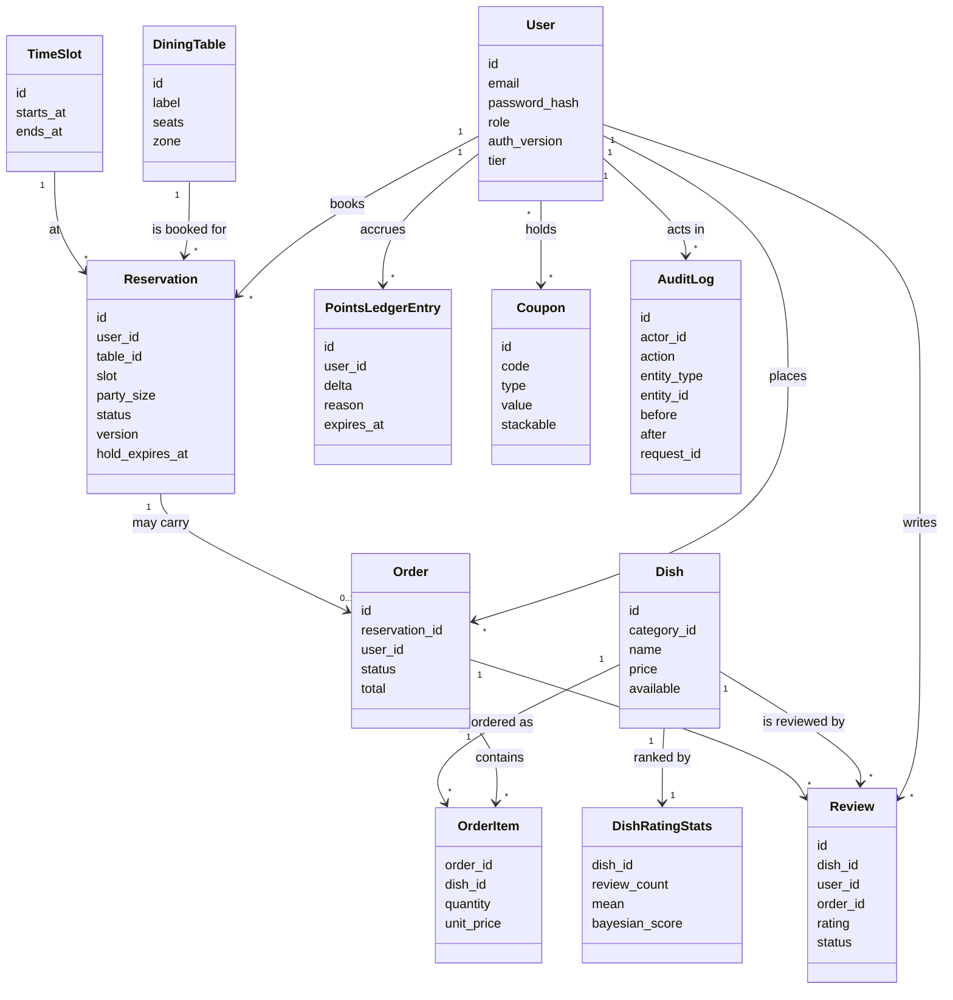
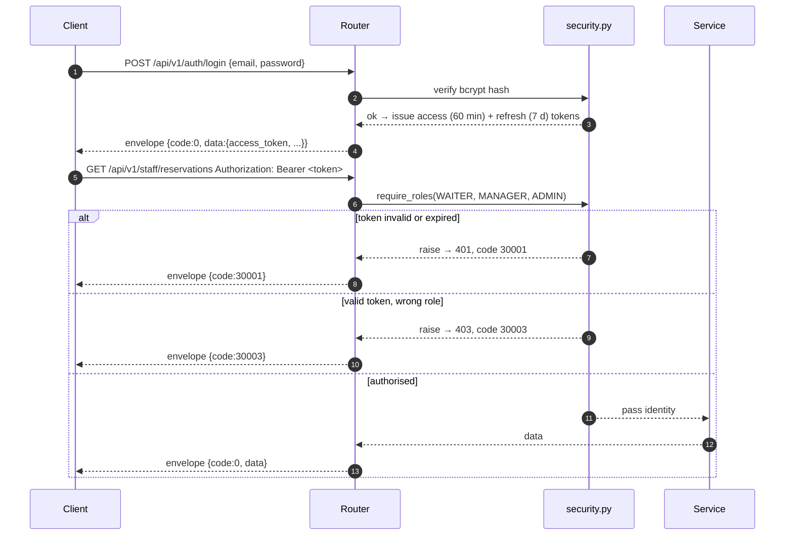
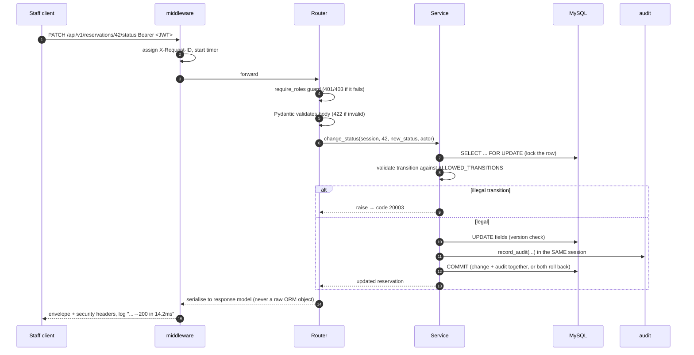
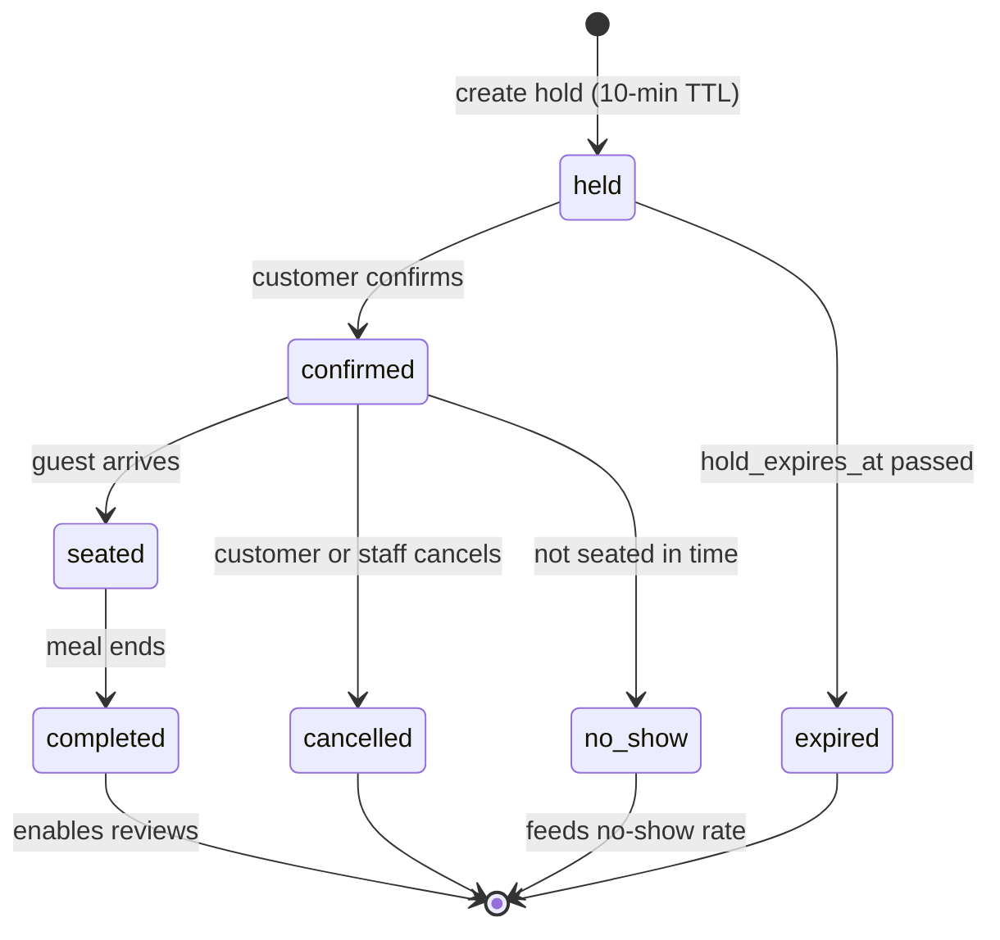
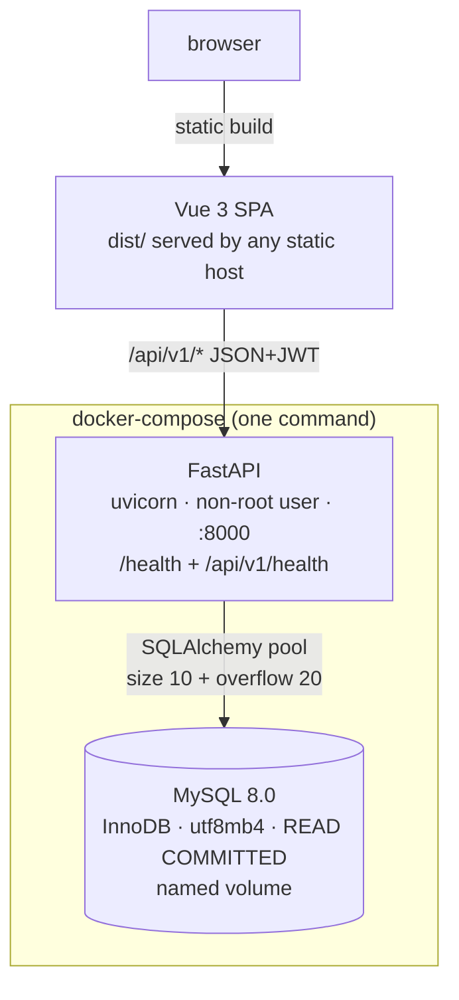

<!--
  AUTHOR: M1 (YAN ZHANG)   SUPPORT: M8
  TARGET: 8–9 pages        DUE: 23 Nov 2026
  STATUS: draft v1 (16 Nov) — complete five-model set; design-vs-implementation gaps flagged
  SOURCES: docs/design/ARCHITECTURE.md (§1–§12), docs/api/openapi.json (20 paths at 9258e0a),
           src/ (real module tree), docs/requirements/REQUIREMENTS.md §3–5
  RULE: no source code. Diagrams, pseudocode and prose only.
  ⚠️ HONESTY RULE for this chapter: it describes the INTENDED architecture and, wherever the
     shipped code diverges, says so explicitly. An architecture chapter that describes a
     design the code does not implement loses the "Consistency and Technical Depth" mark.
     Gaps are marked 🔧 IMPLEMENTATION GAP and cross-referenced to ch.11 §11.7 / ch.12.
-->

# 4. System Design & Architecture

> The marking rubric expects **five** kinds of model in this chapter — a system context
> model, the architectural (three-tier) model, a business process model, a class/domain model
> and sequence models. All five are present below as Figures 4.1 to 4.7. A checklist at the
> end of the chapter tracks them.
>
> This chapter is built from `docs/design/ARCHITECTURE.md`, which is a committed, reviewed
> design document, but it does **not** simply reproduce it: that document is written for the
> developers, this chapter is written for an examiner and explains *why* each decision was
> taken. Where the shipped code on `main` (at `9258e0a`) does not yet match the design, the
> divergence is stated rather than hidden.

## 4.1 Architectural style and rationale

The system is a **three-tier client-server application**: Vue 3 single-page clients talk over
HTTP/JSON to a FastAPI presentation tier, which calls a pure-Python application tier, which
persists through a data tier onto MySQL 8.0. Objective (f) commits the project to a three-tier
architecture, and the choice was made deliberately at the start rather than retro-fitted. Three
properties of this project make the split pay for itself:

1. **The concurrency guarantee gets exactly one home.** All transaction and locking logic lives
   in the data tier. The booking critical section — the single most examined piece of the system
   (§4.6.1) — is written once, in one place, and every caller inherits the same guarantee. Had
   booking logic been scattered across route handlers, Objective (d) could not have been tested
   or trusted, because there would be no single code path to point at.
2. **Ten people can work in parallel.** Each module owns a vertical slice of the application
   tier and cannot break another module's persistence or UI code. Merge conflicts are confined
   to the handful of shared boundaries enumerated in §4.7.3. On a ten-person, twelve-week project
   this is the difference between parallel delivery and serial queueing.
3. **The HTTP boundary is a natural test seam.** Because the application tier is pure Python with
   no `fastapi` import, unit tests call services directly with no HTTP overhead, and the Vue
   clients can be developed against a mocked API. This is why the unit suite runs fast enough to
   gate every pull request (ch.11).

The cost of the split is ceremony: a simple read still crosses three layers. For a
proof-of-concept that is an acceptable trade, because the properties above are exactly the ones
the marking rubric rewards.

## 4.2 System context model  ★ rubric model 1 of 5

**Figure 4.1** shows the system and its environment. Four human actors and one system actor
interact across a single HTTP/JSON boundary; everything the system deliberately does *not* do is
shown as out of scope so the examiner can see the boundary of the deliverable.



*Figure 4.1 — System context model. Solid arrows are interactions across the HTTP boundary; the
dashed arrow is the system actor that triggers behaviour with no user present. The three dashed
boxes are permanently out of scope by proposal decision and are revisited as future work in
ch.13.*

Actors are carried as a `role` claim inside a JSON Web Token and enforced server-side on every
endpoint (§4.6.2). The role-to-endpoint matrix is reproduced in ch.2; the four roles are frozen
and adding a fifth would change every guard in the system.

## 4.3 Three-tier architecture  ★ rubric model 2 of 5

**Figure 4.2** is the tier model. The defining rule is the direction of dependency: each tier
may import the tier below it and the cross-cutting `common` package, but never the tier above
and never another module's internals.



*Figure 4.2 — Three-tier architecture with the cross-cutting common package.*

| Tier | Responsibility | May import | Must NOT know |
|---|---|---|---|
| Presentation (`src/presentation`) | HTTP: routers, request/response models, auth dependencies, the frozen envelope | application, common, data (for `Depends(get_db)`) | business rules |
| Application (`src/application`) | domain rules, state machines, transactions | data, common | HTTP, `fastapi`, SQL dialects, another module's internals |
| Data (`src/data`) | ORM models, repositories, migrations, the engine — the only tier that may contain SQL | common | application, presentation |
| Common (`src/common`) | config, security, audit, middleware, envelope, errors | (nothing in `src/`) | — |

### 4.3.1 The dependency rule and how it is enforced

Two consequences are worth stating because they are enforced by CI, not by convention:

- **`fastapi` must not appear in `src/application/`.** The moment a service takes a `Request` or
  raises `HTTPException` it becomes untestable without an HTTP layer and locked to one framework.
  Services raise *domain* exceptions; routers translate them to the frozen error codes. A unit
  test (`test_application_tier_does_not_import_fastapi`) fails the build if this is violated —
  which caught a real regression during the project (ch.12 §12.8).
- **One module must not import another module's internals.** The review module needs to know
  whether a customer ordered a dish, but it must ask through a published service interface, not
  reach into ordering's repository (§4.7.2).

🔧 **IMPLEMENTATION GAP — one documented deviation.** `src/common/audit.py` imports
`src/data/database` because the `AuditLog` ORM model needs the declarative `Base`. This breaks
the "common imports nothing in `src/`" rule. It is *not* a runtime cycle (`audit → database →
config` terminates), it is whitelisted as a known deviation, and a test fails if the whitelist
entry is left behind after the deviation is removed. The clean fix — moving `AuditLog` into
`src/data/schema/` — changes which Alembic migration owns the table, so it needs a contract
review with the schema owner (M8) rather than a drive-by edit. Recorded as technical debt in
ch.11 §11.7.

## 4.4 Business process model  ★ rubric model 3 of 5

**Figure 4.3** is the end-to-end business flow. It is the diagram that shows the five modules
are one system and not five separate demos: a single customer journey threads through
reservation, ordering, membership and review, and the analytics module reads the history the
others produce.



*Figure 4.3 — Business process model. The `event` edges from order completion are the
cross-module coupling that makes FR-ORD-05, the points award and review eligibility fire from a
single trigger. Dashed edges feed the analytics module, which reads but never writes other
modules' tables.*

The flow makes three design points visible. First, **the order-completion event is the hinge**:
it is what awards points (ch.8) and unlocks review eligibility (ch.9), so three modules depend
on one well-defined trigger rather than on each other's tables. Second, **`NO_SHOW` is a distinct
terminal state**, not a flavour of cancellation, because the no-show rate in ch.10 is computed as
`NO_SHOW / (NO_SHOW + COMPLETED)` and that is impossible if the two are collapsed. Third, the
**analytics module sits downstream of everyone and writes to no one**, which is why it can be
built last without blocking the others.

🔧 **IMPLEMENTATION GAP.** The ordering backend that emits the completion event is not yet
mounted on `main` (the `/api/v1/orders` router is declared in the registry but the module file
is absent), and the loyalty module that consumes it to award points is present only in a
duplicate upload directory, not wired into the running app. The *process* in Figure 4.3 is the
design; ch.6, ch.8 and ch.11 §11.7 record which edges currently execute.

## 4.5 Class / domain model  ★ rubric model 4 of 5

**Figure 4.4** is the logical domain model — the entities and their relationships. This is the
*logical* view; ch.5 gives the *physical* schema (columns, types, indexes, migrations). The two
must describe the same entities; where the shipped schema is narrower than the model, it is
flagged.



*Figure 4.4 — Logical domain model. Cardinalities reflect the design in ARCHITECTURE.md §8; the
`unit_price` on `OrderItem` is a snapshot, not a foreign-key lookup, so a later menu price change
cannot rewrite a settled order (FR-ORD-03).*

🔧 **IMPLEMENTATION GAP — the shipped schema is narrower than this model.** Verified against
`main` at `9258e0a`:

- `src/data/schema/` contains ORM models only for **membership** and **review**; there is no ORM
  model for `reservations` in the schema tier (the reservation model lives in the application
  tier as `src/application/reservation/models.py`), and none for orders, dishes, tables or slots.
- The real `Reservation` model has **six columns** — `id`, `user_id`, `table_id`,
  `reservation_time`, `status`, `created_at`. It has **no `version` column, no `party_size`, no
  `hold_expires_at`, and a single `reservation_time` rather than the `(slot_date, slot_start)`
  pair** the design assumes. Its status enum is `PENDING / CONFIRMED / CANCELLED` — three states,
  not the seven in §4.6.3.
- The loyalty entities (`PointsLedgerEntry`, `Coupon`, tiers) are not in the running schema at
  all (they exist only in the duplicate upload directory).

This is the single largest design-versus-code divergence in the project and it is the root of the
Objective (d) gap: the class model above is the *design*, and ch.5 §5.5 and ch.12 §12.4 record
that the concurrency-critical parts of it (version column, unique constraint) are not yet in the
shipped schema. The diagram is kept as the design because this is a design chapter; it is not
presented as a description of the current tables.

## 4.6 Sequence models  ★ rubric model 5 of 5

Three sequences are given. The first is the project's central claim and is non-negotiable.

### 4.6.1 Concurrent booking — the central claim  (Figure 4.5)

Two customers POST the same table and slot at the same instant. The design guarantees exactly one
succeeds. This sequence shows the three defence layers from ARCHITECTURE.md §5 working together,
and which layer catches which race.

```mermaid
sequenceDiagram
    autonumber
    participant C1 as Customer A
    participant C2 as Customer B
    participant R as Reservation router
    participant S as Reservation service
    participant D as MySQL (READ COMMITTED)

    par two simultaneous requests
        C1->>R: POST /api/v1/reservations {table, slot}
        R->>R: verify JWT, require CUSTOMER
        R->>S: create_reservation(...)
        S->>D: BEGIN; SELECT ... FOR UPDATE (existing row?)
        D-->>S: no row → no gap lock under READ COMMITTED
        S->>D: INSERT reservation (status=held)
    and
        C2->>R: POST /api/v1/reservations {table, slot}
        R->>R: verify JWT, require CUSTOMER
        R->>S: create_reservation(...)
        S->>D: BEGIN; SELECT ... FOR UPDATE (existing row?)
        D-->>S: no row → no gap lock under READ COMMITTED
        S->>D: INSERT reservation (status=held)
        D--xS: IntegrityError — unique(active_slot_key) violated
        S-->>R: map IntegrityError → code 20001
        R-->>C2: 200 envelope {code:20001, "slot already booked"}
    end
    D-->>S: A's INSERT commits
    S-->>R: created (id, status=held)
    R-->>C1: 200 envelope {code:0, data:{id}}
```

*Figure 4.5 — Concurrent booking. Under READ COMMITTED both inserts pass the existence check (no
gap lock on a non-existent row); the **unique constraint on the active-slot generated column is
what makes the second fail**, and the service translates that `IntegrityError` into business code
`20001`. This is why the guarantee is real rather than hopeful.*

The three layers, and the race each catches (ARCHITECTURE.md §5):

| Race | Caught by | Business code |
|---|---|---|
| Two updates to one *existing* reservation | record lock (`FOR UPDATE`) + version check | `20004` stale data |
| Two inserts into one *free* slot | unique constraint on the active-slot key | `20001` slot taken |
| Any path that forgot to lock | unique constraint (cannot be forgotten) | `20001` slot taken |

The isolation level is the subtle part and worth a paragraph in the report. The project sets
**READ COMMITTED** explicitly (per session and at the server level), not MySQL's default
REPEATABLE READ. Under REPEATABLE READ the insert race *would* be serialised by gap locks — at
the cost of frequent deadlocks between concurrent inserts into adjacent gaps on the hottest path
in the system. The design trades that for fewer deadlocks and relies on the unique constraint
instead, which is a strictly stronger guarantee: a constraint cannot be forgotten by a code path
the way a lock can. The unique constraint cannot be the obvious `UNIQUE(table, slot)`, because
that would prevent a table ever being rebooked after a cancellation; it is expressed on a
**generated column** that is non-NULL only for active states, exploiting the fact that a MySQL
unique index permits multiple NULLs. (Full treatment in ch.5 §5.5.)

🔧 **IMPLEMENTATION GAP — this sequence is the design, not current behaviour.** At `9258e0a` the
reservation service performs a plain read-then-create with **no conflict detection**, and the
`reservations` table has **no version column and no unique constraint**. There is therefore
nothing that would make Customer B's insert fail: today both would succeed. The committed
concurrency test does not run (ch.12 §12.4). This figure stays in the chapter because it is the
intended design and the target of the 30 Nov deadline; ch.12 evaluates the gap honestly.

### 4.6.2 Authentication and authorisation  (Figure 4.6)



*Figure 4.6 — Authentication and authorisation. The contract distinguishes "who are you" (401 /
`30001`) from "you may not" (403 / `30003`); conflating them is a common API defect this project
deliberately avoids (FR-MEM-02).*

### 4.6.3 Request lifecycle and the reservation state machine  (Figure 4.7)



*Figure 4.7 — Back-office request lifecycle. The audit row is written inside the same transaction
as the change it describes, so the trail can never record a change that did not happen (and a
change can never land without a trail). The X-Request-ID appears in the response header, the
application log and the audit row, correlating all three.*

The reservation state machine the service validates against is:



*Figure 4.8 — Reservation state machine (design, ARCHITECTURE.md §9). Transitions not drawn are
rejected by the service with code `20003`. Only `completed` enables dish reviews — the structural
basis for "only customers who actually ordered" (Objective c).*

🔧 **IMPLEMENTATION GAP.** The shipped status enum is `PENDING / CONFIRMED / CANCELLED` (three
states) and there is no `ALLOWED_TRANSITIONS` table or transition validation in the service. The
seven-state machine above is the design; `held`, `seated`, `completed`, `expired` and `no_show`
are not yet implemented, which also means the no-show rate (ch.10) has no data to compute. Owned
by M2; due with the reservation module.

## 4.7 API design

### 4.7.1 Conventions

The REST surface follows one frozen contract, which is what lets ten people write clients and
servers independently:

- **One base path per module**, each owned by one person: `/api/v1/reservations`,
  `/api/v1/orders`, `/api/v1/staff`, `/api/v1/membership`, `/api/v1/reviews`,
  `/api/v1/analytics`. Resource names are plural nouns.
- **A single response envelope** on every call, success or failure:
  `code / message / data / request_id / timestamp`. A client written against one module works
  against all of them.
- **Five-digit business codes**, distinct from the HTTP status. `code:0` is success; `1xxxx`
  validation; `2xxxx` business rules (including `20001` slot conflict, `20003` illegal
  transition, `20004` stale data); `3xxxx` authorisation (`30001` unauthenticated, `30003` wrong
  role); `5xxxx` server error. The HTTP status tells the transport what happened; `code` tells the
  application *which rule* was violated, and the frontend switches on `code`.
- **`X-Request-ID`** on every response, mirrored into the log and any audit row the request
  produced (§4.6.3).
- **ISO 8601 UTC** timestamps with a `Z` suffix; **bounded pagination** (`page_size ≤ 100`,
  `10002` above it).

### 4.7.2 The router registry

`main.py` holds a `_MODULE_ROUTERS` table mapping each module name to an import path and its
frozen prefix, and a loader that mounts whatever exists. A module whose router file is missing is
logged and skipped rather than crashing the app, so an unimplemented module never takes `/health`
down with it. A router that *exists* but is malformed is logged loudly with a traceback, because a
typo in merged code should be visible.

### 4.7.3 The current mounted surface

At `9258e0a` the generated OpenAPI document lists **20 paths** across seven prefixes:

| Prefix | Mounted paths | Status |
|---|---|---|
| `/` , `/api/v1/health` | 2 | ✅ |
| `/api/v1/auth/*` | register, login, logout, refresh, csrf, me (6) | ✅ |
| `/api/v1/users/*` | list, create, change role, change status (4) | ✅ |
| `/api/v1/reservations` | create, cancel (2) | ⚠️ mounted, no conflict detection (§4.6.1) |
| `/api/v1/staff/*` | reservations list/status, orders list/status (4) | ⚠️ reservation side real, order side placeholder |
| `/api/v1/reviews/*` | submit, ranking (2) | ✅ (no rate limit yet) |
| `/api/v1/membership/profile` | 1 | ✅ |
| `/api/v1/analytics/*` | dashboard, revenue, turnover, heatmap, noshow, recommendations | ⚠️ mounted, returns hardcoded data |
| `/api/v1/orders` | — | 🔴 declared in the registry, **not mounted** (module file absent) |

🔧 **IMPLEMENTATION GAP — two contracted prefixes are not live.** `/api/v1/orders` is absent
entirely (the router file does not exist, so the tolerant loader skips it), and `/api/v1/analytics`
is mounted but returns mock figures. The tolerant loader (§4.7.2) is why this fails *silently*: a
declared-but-missing router is logged at debug level, not surfaced as an error. ch.11 §11.7
recommends making the loader fail — or emit a CI-visible warning — once every contracted module is
expected to exist. Until then the committed `openapi.json` and the running app can disagree, which
is why FR-XX-04 requires re-exporting it after every route change.

## 4.8 Data design overview

The data tier is the only place SQL may appear. Schema changes go exclusively through Alembic
migrations (never `create_all()` in deployment), the migration chain runs against a real MySQL 8
in CI, and a completeness test fails the build if a model lacks a migration. The physical schema —
entities, columns, the generated-column unique constraint, indexing and the migration history — is
the subject of ch.5.

## 4.9 Frontend architecture

Two Vue 3 + Vite + TypeScript single-page clients are committed: the customer app under
`frontend/` (menu browsing, category filter, cart, order submission) and the membership
authentication app under `src/presentation/membership/` (login, register, account, with its own
CI workflow). Both are built separately and served as static assets; they talk to the API over
HTTP using the envelope contract, and store the access token in client state rather than
`localStorage` (an XSS mitigation, ch.11).

🔧 **IMPLEMENTATION GAP.** A manager dashboard component (`AnalyticsDashboard.vue`) was added
recently but is **not imported or mounted** by the customer app's root component, so it is not
reachable by a user; there is no separate staff or manager SPA. The proposal's "three Vue clients"
is therefore not what ships: ch.1 §1.4 and ch.11 §11.7 state the delivered surfaces honestly.

## 4.10 Deployment architecture



*Figure 4.9 — Deployment topology. The SPA and the API deploy separately; JWT (stateless) was
chosen over server sessions precisely because there is no shared session store between them. The
compose stack maps host 3307 → container 3306 to avoid clashing with a developer's local MySQL,
and the API container runs `alembic upgrade head` before serving so a fresh volume cannot run
against an un-migrated schema.*

The Dockerfile is a multi-stage build that ships only the runtime and installed wheels (no
compiler toolchain), runs as a non-root `appuser`, and carries a `HEALTHCHECK` against `/health`.
Full start-up steps are in `INSTALL.md`.

🔧 **VERIFICATION GAP.** The image builds in CI (`Docker build` is green) but has **never been run
end-to-end on a clean machine** — the maintainer's machine has no Docker. `INSTALL.md` says so
explicitly, and a clean-machine run is a tracked pre-submission task (14 Dec), because
reproducibility for the examiner is a marked criterion.

## 4.11 Design decisions and trade-offs

The rubric rewards justified decisions, not merely described ones. The significant choices, with
what each costs:

| Decision | Why | What it costs |
|---|---|---|
| **MySQL over PostgreSQL** | InnoDB gives transactions, row locks and unique constraints — everything Objective (d) needs; the team knows it | PostgreSQL exclusion constraints would express "no overlapping ranges" directly; we use a discrete slot grid + unique constraint instead |
| **Discrete 30-min slots, not free-form ranges** | `UNIQUE(table, slot)` is simple, indexable and provably correct; range-overlap is not enforceable by a unique constraint in MySQL | Bookings snap to a grid; slot length is fixed up front |
| **READ COMMITTED, set explicitly** | Avoids gap-lock deadlocks on the hot insert path; correctness then rests on the unique constraint, which cannot be forgotten | The `FOR UPDATE` behaviour differs from most tutorials (which assume REPEATABLE READ); must be understood, not copied |
| **Generated-column unique index** | MySQL has no partial index; a generated column that is NULL for inactive states + a unique index gives "unique among active" | More moving parts than a plain constraint; the expression must be deterministic |
| **JWT over server sessions** | Frontend and API deploy separately; a stateless token needs no shared store | Revocation before expiry needs an explicit mechanism (`auth_version` + session table); the `jti` deny-list is designed but not fully wired |
| **Append-only points ledger** | A mutable balance is a lost-update hazard and leaves no audit trail; a ledger is idempotent to re-read and makes expiry a query, not a mutation | Balance must be computed by summing unexpired entries |
| **Bayesian average, not plain mean** | Stops a dish with one 5★ review outranking one with 200 at 4.8★ | A confidence parameter `m` and global mean `C` must be chosen and justified (ch.9) |
| **Audit rows inside the business transaction** | A trail recording a change that never happened is worse than none | Audit writes cannot be deferred to a queue |
| **Tolerant router loader** | Lets ten people merge in parallel; a missing module cannot break `/health` | A declared-but-missing router fails silently — the reason `/api/v1/orders` is absent without any check going red (§4.7.3) |

The last row is the clearest example of a decision whose benefit and whose price are both real,
and stating both is worth more marks than a clean story.

---

## ★ The five-model checklist — all present

- [x] 4.2 System context model — **Figure 4.1**
- [x] 4.3 Three-tier architecture — **Figure 4.2**
- [x] 4.4 Business process model — **Figure 4.3**
- [x] 4.5 Class / domain model — **Figure 4.4**
- [x] 4.6 Sequence models — **Figures 4.5, 4.6, 4.7** (+ state machine **4.8**, deployment **4.9**)

## Author's notes — to resolve before merging

- [ ] **Length.** This draft is ~6–7 pages at the required formatting; target is 8–9. The honest
      expansion is §4.6.1 (the concurrency argument) and §4.11 (decision rationale), not new
      figures — both are where the Technical Depth marks are.
- [ ] **Every 🔧 IMPLEMENTATION GAP must be re-checked against `main` on the day of merging**
      (23 Nov). Several are being worked on; if a gap closes, move that text into the body and
      delete the flag. The chapter is only trustworthy if the flags match reality at submission.
- [ ] **Coordinate Figure 4.4 (logical model) with M8's ch.5 (physical schema).** They are two
      views of one model and must not contradict; the version column and unique constraint appear
      in both, and both currently record them as design-not-yet-shipped.
- [ ] **Mermaid → image export.** M7 exports all figures to PNG/SVG for the PDF at merge time;
      give M7 the list (Figures 4.1–4.9).
- [ ] **Reuse Figure 4.5 in the presentation.** It is the centrepiece of the demo (manual §8.4);
      build it once here and let M4/M6 reuse the export.
- [ ] **Do not paste source.** ARCHITECTURE.md contains code; this chapter must describe it in
      prose and pseudocode only (school rule). The generated-column constraint is described, not
      quoted as DDL.
