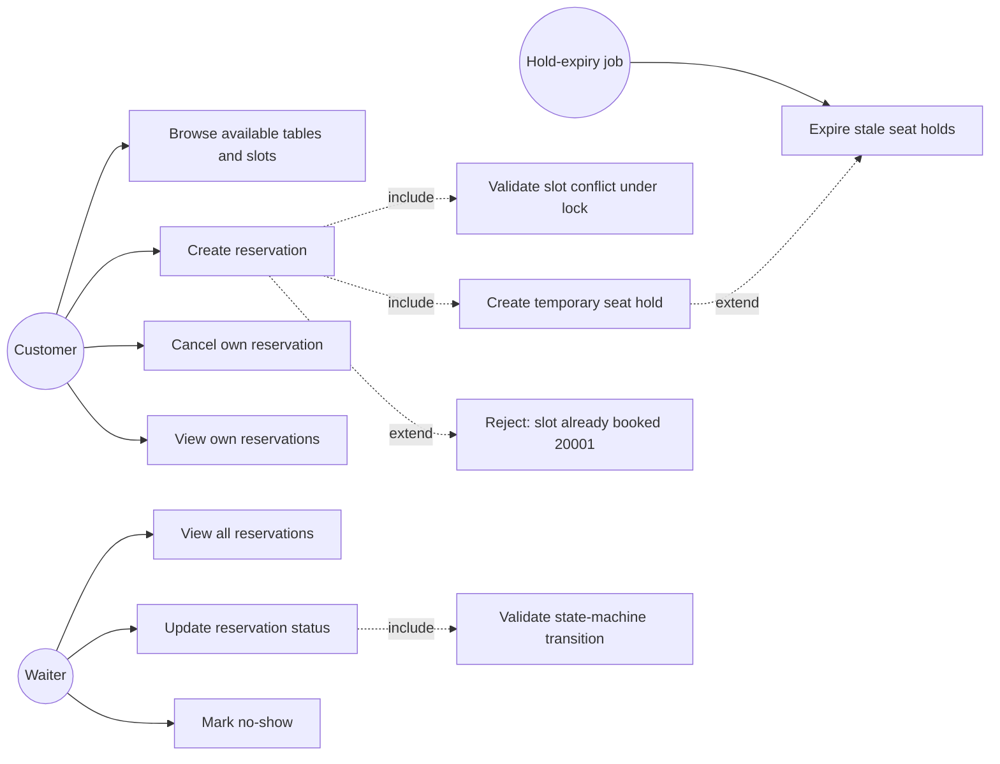
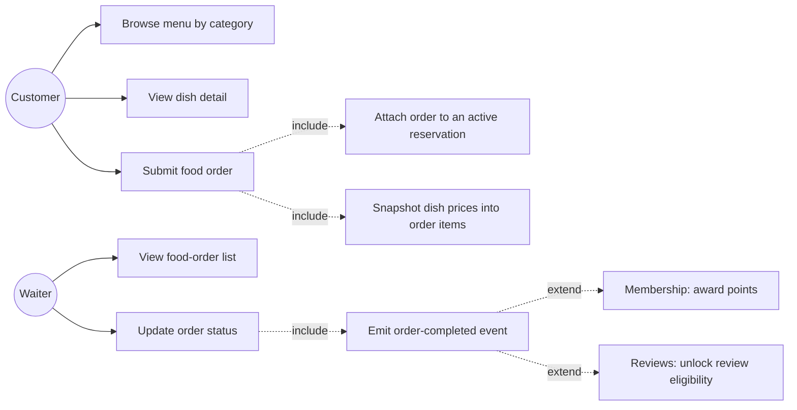
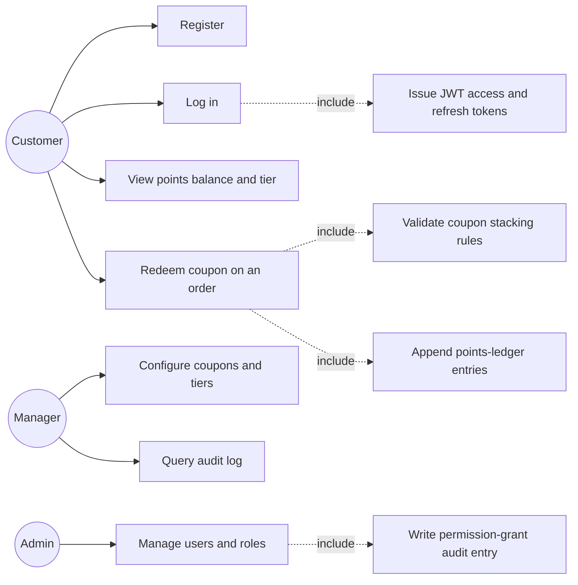
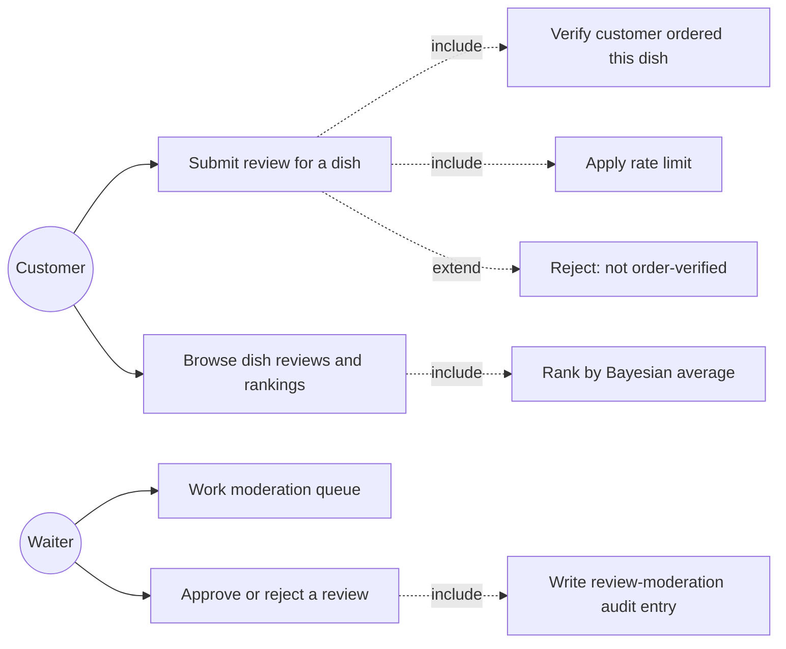
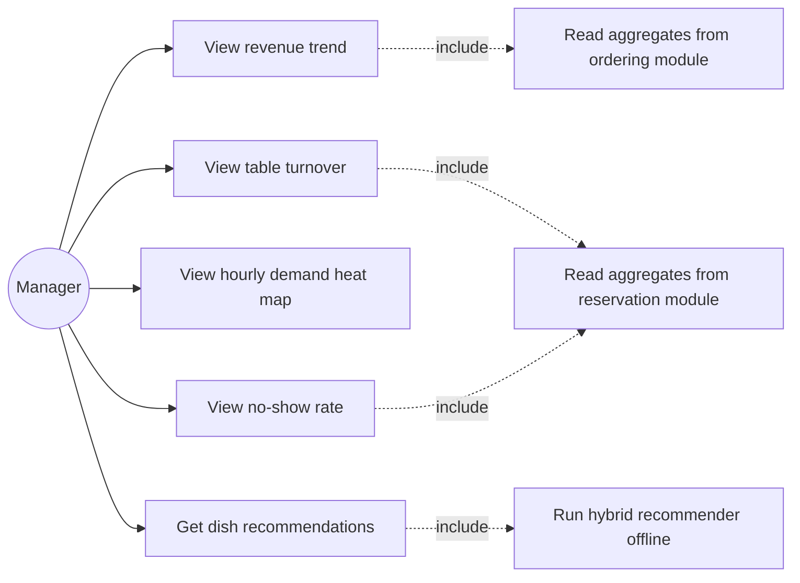

# Requirements Specification

**JC2001 BMIS Group 4 — Restaurant Reservation and Food-Ordering System**
Phase 1 deliverable (Requirement & Design, due **12 Oct 2026**), Project Update 1 evidence.

> Sources: `JC2001 Group Project Proposal - group 4 (new version).pdf` (the commitment made to
> the school), `docs/design/ARCHITECTURE.md`, and the frozen contracts in
> `JC2001-Group4-协作与统一标准手册.md` chapters 4 and 5. Where this document and the manual
> disagree, **the manual wins** — it is the frozen contract. This file records *what* the system
> must do; the manual records *how the pieces talk to each other*.

Requirement IDs are stable: `FR-<MOD>-<nn>` for functional, `NFR-<nn>` for non-functional.
Every FR traces to a proposal objective and to the test that will prove it (§7). Do not renumber —
the technical report and the workload profile will cite these IDs.

---

## 1. Scope restated in one paragraph

A proof-of-concept web system for small restaurants that moves reservations and food ordering
online, guarantees that two customers can never take the same table for the same time slot, and
turns booking and order data into management insight. Five modules: Reservation, Ordering,
Membership & Loyalty, Ratings & Reviews, Analytics. Out of scope, permanently: online payment,
SMS notification, any commercial cloud database / payment / messaging API.

---

## 2. Actors

| Actor | Description | Role claim in JWT |
|---|---|---|
| **Customer** | End user: books seats, browses the menu, orders, reviews dishes they actually ordered, earns points | `customer` |
| **Waiter** | Restaurant staff: sees all reservations, updates reservation status, handles food orders, moderates reviews | `waiter` |
| **Manager** | Restaurant management: everything a waiter can do, plus the analytics dashboard and coupon/tier configuration, plus audit-log queries | `manager` |
| **Admin** | System administration: everything a manager can do, plus user and role management | `admin` |
| **Hold-expiry job** *(system actor)* | Background process that expires stale seat holds every 60 s | — (no token) |

The four human roles are **frozen** (manual §4.4): do not add a fifth. The role-to-endpoint matrix
is frozen in manual §4.4 and reproduced here only where a requirement depends on it.

---

## 3. Use-case diagrams

One diagram per module. Dashed arrows are `«include»` / `«extend»` relations; the
hold-expiry job is drawn as a system actor because it triggers behaviour without a user.

### 3.1 Reservation module (Objective a)

### 3.2 Ordering module (Objective a, b)

### 3.3 Membership & Loyalty module (Objective c)

### 3.4 Ratings & Reviews module (Objective c)

### 3.5 Analytics module (Objective e)

**Rule for M6 (analytics owner):** the dashboard never writes cross-module SQL. It consumes the
aggregate endpoints or database views that M2/M5 provide (manual §4.6).

---

## 4. Functional requirements

### 4.1 Reservation (`RES`)

| ID | Requirement | Priority | Owner |
|---|---|---|---|
| FR-RES-01 | The system shall let a customer see, for any future date, which tables have a free slot, showing table label, seat count and zone. | Must | M2 |
| FR-RES-02 | The system shall create a reservation in state `HELD` with `hold_expires_at = now + 10 min`, and confirm it into `CONFIRMED` only on explicit customer confirmation. | Must | M2 |
| FR-RES-03 | The system shall guarantee that at most one active reservation exists per (table, slot): a concurrent second request shall fail with error code `20001`, never with a duplicate row. | Must | M2 + M8 |
| FR-RES-04 | The system shall expire `HELD` reservations whose `hold_expires_at` has passed, releasing the slot; expiry must be correct even if the background job is down (expired holds must not count as occupying). | Must | M2 |
| FR-RES-05 | The system shall enforce the reservation state machine (`HELD → CONFIRMED → SEATED → COMPLETED`, plus `CANCELLED`, `NO_SHOW`, `EXPIRED` as in manual §4.5); an illegal transition shall return `20003`. | Must | M2 |
| FR-RES-06 | The system shall let waiter/manager/admin list all reservations and change their status; customers may list and cancel only their own. | Must | M3 (UI) / M2 (API) |
| FR-RES-07 | The system shall record a distinct terminal state `NO_SHOW` (not a flavour of `CANCELLED`) so the no-show rate is computable. | Must | M2 |
| FR-RES-08 | Every reservation write shall produce an audit row naming the actor, the before/after status and the request id. | Must | M2 |

### 4.2 Ordering (`ORD`)

| ID | Requirement | Priority | Owner |
|---|---|---|---|
| FR-ORD-01 | The system shall present the menu grouped by category, with dish name, description, price and availability. | Must | M5 |
| FR-ORD-02 | The system shall let a customer with an active reservation submit a food order attached to that reservation. | Must | M5 |
| FR-ORD-03 | The system shall copy each dish's price into the order item at order time; later menu price changes must not alter existing orders. | Must | M5 |
| FR-ORD-04 | The system shall let waiter/manager view the food-order list and advance order status through `PENDING → ACCEPTED → PREPARING → SERVED → COMPLETED` (or `CANCELLED`). | Must | M3 / M5 |
| FR-ORD-05 | When an order reaches `COMPLETED`, the system shall emit the event that (a) awards points and (b) unlocks review eligibility for its dishes. | Must | M5 |

### 4.3 Membership & Loyalty (`MEM`)

| ID | Requirement | Priority | Owner |
|---|---|---|---|
| FR-MEM-01 | The system shall support registration and login for the four frozen roles, issuing a 60-minute access token and a 7-day refresh token. | Must | M10 |
| FR-MEM-02 | The system shall enforce the frozen role-permission matrix (manual §4.4) server-side on every endpoint; a valid token with the wrong role yields `30003`, never `401`-as-403 confusion. | Must | M10 |
| FR-MEM-03 | The system shall keep an **append-only** points ledger (`EARN / REDEEM / EXPIRE / ADJUST`); balances are derived by summing unexpired entries, never edited in place. | Must | M4 |
| FR-MEM-04 | The system shall apply membership tiers (`BRONZE / SILVER / GOLD / PLATINUM`) with thresholds defined in the contract. | Should | M4 |
| FR-MEM-05 | The system shall apply coupons with explicit stacking rules (`EXCLUSIVE` vs `STACKABLE`); the evaluation order of stacked discounts shall be defined in the contract and tested. | Should | M4 |
| FR-MEM-06 | Every points adjustment, coupon issue/redemption and role change shall write an audit row. | Must | M4 / M10 |

### 4.4 Ratings & Reviews (`REV`)

| ID | Requirement | Priority | Owner |
|---|---|---|---|
| FR-REV-01 | The system shall accept a review only from a customer whose `COMPLETED` order contains the reviewed dish; others get the not-order-verified error. | Must | M9 |
| FR-REV-02 | The system shall prevent the same customer reviewing the same dish twice for the same order (unique `(dish_id, customer_id, order_id)`). | Must | M9 |
| FR-REV-03 | The system shall rank dishes by **Bayesian average**, not plain mean, so a dish with one 5★ review cannot outrank a dish with 200 4.8★ reviews. | Must | M9 |
| FR-REV-04 | The system shall rate-limit review submission (default 5/minute per user) and record limit hits. | Must | M9 |
| FR-REV-05 | The system shall hold new reviews in `PENDING` until waiter/manager approve or reject them; rejected reviews never appear publicly. | Must | M9 |

### 4.5 Analytics (`ANA`)

| ID | Requirement | Priority | Owner |
|---|---|---|---|
| FR-ANA-01 | The system shall show revenue trend over a selectable date range. | Must | M6 |
| FR-ANA-02 | The system shall show table turnover (seatings per table per day). | Must | M6 |
| FR-ANA-03 | The system shall show an hourly demand heat map (day-of-week × hour). | Must | M6 |
| FR-ANA-04 | The system shall show no-show rate = `NO_SHOW / (NO_SHOW + COMPLETED)` over the range. | Must | M6 |
| FR-ANA-05 | The system shall provide dish recommendations from a hybrid recommender, evaluated offline with Precision@K and MAE. | Should | M6 |

### 4.6 Cross-cutting (`XX`)

| ID | Requirement | Priority | Owner |
|---|---|---|---|
| FR-XX-01 | Every endpoint shall return the frozen envelope `code / message / data / request_id / timestamp` (manual §4.2); failures use the frozen 5-digit codes. | Must | M1 |
| FR-XX-02 | Every response shall carry the `X-Request-ID` header; the same id appears in the application log and in any audit row produced by that request. | Must | M1 |
| FR-XX-03 | Back-office state changes (reservation status, order status, review moderation, points, coupons, roles) shall be audit-logged with before/after snapshots. | Must | M1 + module owners |
| FR-XX-04 | The OpenAPI document shall be generated from the running app and archived at `docs/api/openapi.json` after every route change. | Must | M1 |

---

## 5. Non-functional requirements

| ID | Requirement | Verification |
|---|---|---|
| NFR-01 | **Concurrency correctness**: with N ≥ 50 simultaneous booking requests for one table and slot, exactly one succeeds (`code 0`) and the rest get `20001`; the database afterwards holds exactly one active row. Repeatable 10× with identical results. | `tests/concurrency/` + `scripts/concurrency_test.py` (M7) |
| NFR-02 | **Test coverage**: unit coverage ≥ 80 % of `src/` at final submission; concurrency and integration tests run against a real MySQL 8. | CI coverage gate |
| NFR-03 | **CI**: every pull request runs hygiene, lint, types, security scan, unit, integration, frontend and docker jobs; merge requires the aggregate check green. | Branch ruleset `protect-main` |
| NFR-04 | **Security (OWASP Top 10)**: parameterised queries only; bcrypt cost ≥ 12; secrets from environment only; production refuses placeholder secrets and wildcard CORS; `/docs` disabled in production; rate limiting on review submission; non-root container. | bandit + pip-audit in CI; manual §10 mapping in ARCHITECTURE.md |
| NFR-05 | **Auditability**: audit rows are append-only and survive application restart; credential-like keys are redacted before storage. | `tests/unit/test_audit.py` |
| NFR-06 | **Deployability**: `docker compose up --build` starts MySQL 8 + API; `/health` returns 200; migrations apply automatically on start. | CI docker job smoke test |
| NFR-07 | **Data**: MySQL 8 InnoDB, `utf8mb4`, REPEATABLE READ; all schema changes via Alembic migrations that are reversible (`downgrade` written). | manual §5.2 |
| NFR-08 | **Documentation**: REST API documented via OpenAPI; user manual covers all five modules including installation. | `docs/api/`, `docs/user-manual/` |
| NFR-09 | **Performance (bounded)**: list endpoints paginate (`page_size` ≤ 100, code `10002` above); dashboard reads aggregates, not raw tables, on the hot path. | manual §4.2 |

---

## 6. Open business rules — **decide before Wave 2 coding starts**

Status of the eight questions in `ARCHITECTURE.md` §13, checked against the frozen manual:

- **Fully decided (2):** slot granularity = 30 min (manual §5.1); moderation = hold until approved
  (manual §4.5 `ReviewStatus`).
- **Partially decided (2):** points — the ledger being append-only and the transaction types are
  frozen (manual §4.5), but the *earning rate and expiry window* are not; coupons — the stacking
  vocabulary `EXCLUSIVE`/`STACKABLE` is frozen (manual §4.5), but the *application order* is not.
- **Open (4):** max table occupation, Bayesian `m`, recommender definition, no-show definition.

Decomposing the two partial ones into their decided and open halves gives the table below:
3 decided rows, 6 rows awaiting a group decision. Proposed values are *suggestions for the group
chat*, not decisions — whoever owns the row brings it to the group and writes the agreed value
back into the contract (manual §4.5 / §5) by PR. That PR is the only legitimate way to change a
frozen value; editing code to match an undocumented verbal agreement is how ten people end up
with eleven contracts.

| # | Question | Status | Proposed value for discussion | Owner | Needed by |
|---|---|---|---|---|---|
| 1 | Slot granularity | ✅ **Decided**: 30 minutes (manual §5.1 `time_slots`) | — | M2 + M8 | done |
| 2 | Review moderation policy | ✅ **Decided**: hold in `PENDING` until approved (manual §4.5 `ReviewStatus`) | — | M9 | done |
| 3 | Points ledger mutability | ✅ **Decided**: append-only (manual §4.5 `PointsTxnType`) | — | M4 | done |
| 4 | Max table occupation per seating | ⬜ open | 120 min, enforced as a soft warning at booking, hard cap at 180 min | M2 | 20 Oct |
| 5 | Points earning rule + expiry window | ⬜ open (append-only is decided; the *rate* is not) | 1 point per ¥10 spent; points expire 12 months after earning | M4 | 20 Oct |
| 6 | Coupon stacking order | ⬜ open | `EXCLUSIVE` coupons never combine; among `STACKABLE`, apply percentage first then fixed amount, capped at order total | M4 | 20 Oct |
| 7 | Bayesian confidence `m` | ⬜ open | `m = 15`, recomputed `C` nightly; document the choice in the technical report | M9 | 10 Nov |
| 8 | Hybrid recommender definition | ⬜ open | 0.7 × item-based collaborative filtering + 0.3 × category-content similarity; evaluate on the 500 seeded orders | M6 | 10 Nov |
| 9 | No-show definition | ⬜ open | `CONFIRMED` not `SEATED` within 20 min of slot start → staff marks `NO_SHOW` | M6 + M2 | 20 Oct |

**Why this gate exists:** questions 4–6 change column definitions and the order in which money is
computed; questions 7–9 change what the analytics module measures. Deciding them after code exists
means rewriting migrations and tests, which is the single most expensive rework available to this
team.

---

## 7. Traceability matrix

Objective (proposal) → requirement → test that proves it → owner.

| Objective | Requirements | Test evidence | Owner |
|---|---|---|---|
| (a) customer reservation + ordering | FR-RES-01/02/04/05, FR-ORD-01/02/03 | unit + integration | M2, M5 |
| (b) staff backend | FR-RES-06, FR-ORD-04 | integration (role matrix) | M3 |
| (c) membership, loyalty, reviews | FR-MEM-01..06, FR-REV-01..05 | unit + integration | M10, M4, M9 |
| (d) concurrency correctness + testing | FR-RES-03, NFR-01, NFR-02 | `tests/concurrency/`, CI coverage | M8, M4, M7 |
| (e) analytics + recommender | FR-ANA-01..05 | integration against seeded data | M6 |
| (f) engineering quality | FR-XX-01..04, NFR-02..08 | CI pipeline, bandit, pip-audit | M1 |
| (g) proposal / updates / presentation | this document + Update 1 | submitted forms | M1, M4, M6, M7 |

---

## 8. Assumptions and constraints

1. The restaurant operates on a fixed slot grid; walk-in seating is out of scope.
2. One restaurant (single tenant). Multi-tenancy would change every uniqueness constraint.
3. Seed data (20 tables, 50 dishes, 100 customers, 500 historical orders, 200 reviews — manual §5.4)
   is a Wave-1 deliverable owned by M8: the dashboard and the recommender cannot be demonstrated
   without it.
4. All dates/times are stored UTC and rendered in the client's locale; API payloads use ISO 8601
   with a `Z` suffix (manual §4.1).
5. This is a proof of concept: no real payments, no real SMS, no production PII beyond what a
   demo account needs.
